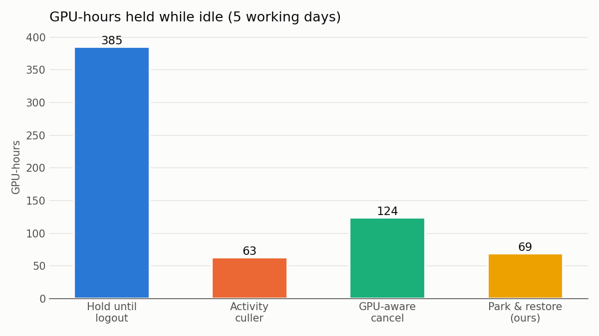
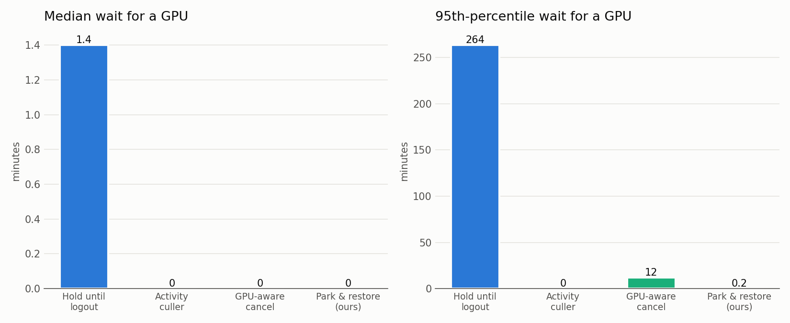
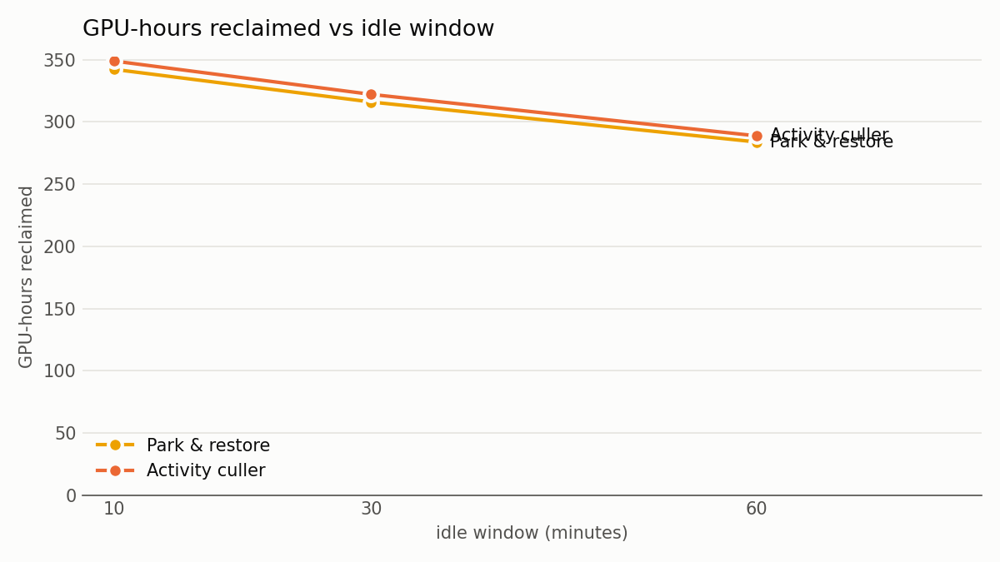
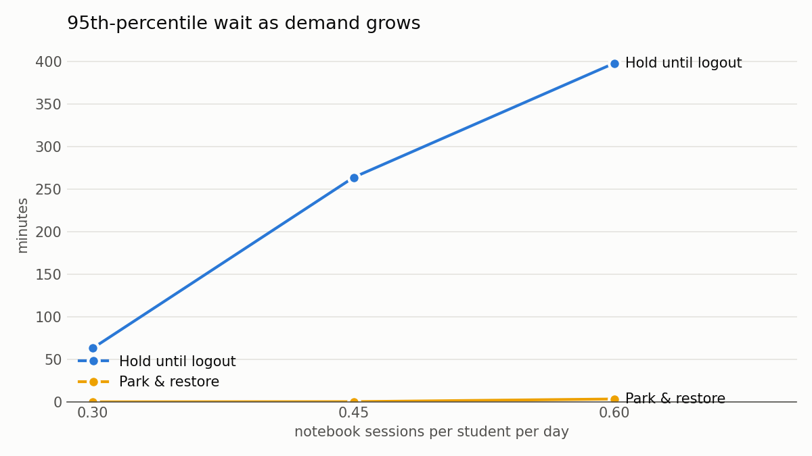

# Simulator results

Lab: 4 machines x 2 GPUs = 8 GPUs, 40 students, 5 working days, 0.45 notebook sessions per student per day (mean) + 12 Helios batch jobs per day. Mean of 5 seeds (42-46). Park 1.2 s, restore 0.27 s (measured on the laptop). Idle window 30 min + 5 min grace for park-and-restore.

## Four policies, same workload

| Policy | Idle GPU-h held | GPU-h reclaimed | Median wait (min) | p95 wait (min) | Sessions with lost state | GPU-h re-running lost work | Jain fairness |
| --- | --- | --- | --- | --- | --- | --- | --- |
| Hold until logout | 385 | 0 | 1.4 | 264 | 0 of 84 | 0.0 | 0.46 |
| Activity culler (kill after 30 min) | 63 | 322 | 0.0 | 0 | 70 of 84 | 4.1 | 0.45 |
| GPU-aware cancel (warn 45, cancel 90 min) | 124 | 262 | 0.0 | 12 | 48 of 84 | 0.9 | 0.54 |
| Park and restore (idle 30 min, ours) | 69 | 316 | 0.0 | 0 | 0 of 84 | 0.0 | 0.46 |

GPU-hours reclaimed = idle GPU-hours held under hold-until-logout minus idle GPU-hours held under the policy. Waits include every request: first requests, and returns after a park (incl. restore time) or a kill. Jain fairness is over GPU-hours held per student.

## Idle-window sensitivity

| Idle window | Policy | GPU-h reclaimed | p95 wait (min) | Parks / kills | Warned, then resumed | Returns | p95 wait on return (min) | Sessions with lost state |
| --- | --- | --- | --- | --- | --- | --- | --- | --- |
| 10 min | Activity culler | 349 | 0 | 79 | 0 | 10 | 0.0 | 79 |
| 10 min | Park and restore | 342 | 0 | 88 | 15 | 14 | 0.0 | 0 |
| 30 min | Activity culler | 322 | 0 | 70 | 0 | 8 | 0.0 | 70 |
| 30 min | Park and restore | 316 | 0 | 73 | 1 | 8 | 0.0 | 0 |
| 60 min | Activity culler | 289 | 4 | 58 | 0 | 3 | 1.7 | 58 |
| 60 min | Park and restore | 284 | 6 | 59 | 0 | 3 | 2.6 | 0 |

## Load sensitivity

| Sessions / student / day | Policy | Median wait (min) | p95 wait (min) | Idle GPU-h held |
| --- | --- | --- | --- | --- |
| 0.3 | Hold until logout | 0.0 | 63 | 252 |
| 0.3 | Park and restore | 0.0 | 0 | 47 |
| 0.45 | Hold until logout | 1.4 | 264 | 385 |
| 0.45 | Park and restore | 0.0 | 0 | 69 |
| 0.6 | Hold until logout | 36.2 | 398 | 538 |
| 0.6 | Park and restore | 0.0 | 3 | 92 |

## Workload calibration (NotebookOS targets)

| Statistic | Published | Generated |
| --- | --- | --- |
| median task length | 2 min | 2.0 min |
| tasks shorter than 5 min | 75% | 76.2 % |
| median gap between tasks | 5 min | 5.0 min |
| gaps shorter than 8 min | 75% | 75.4 % |
| sessions GPU-active <= 5% of lifetime | 74-75% | 72.8 % |
| sessions GPU-active <= 31% of lifetime | 90% | 91.0 % |
| sessions never GPU-active | ~70% ("nearly 70%") | 66.4 % |
